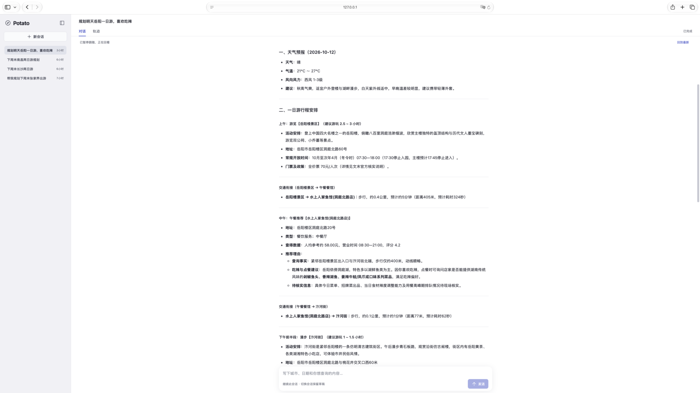
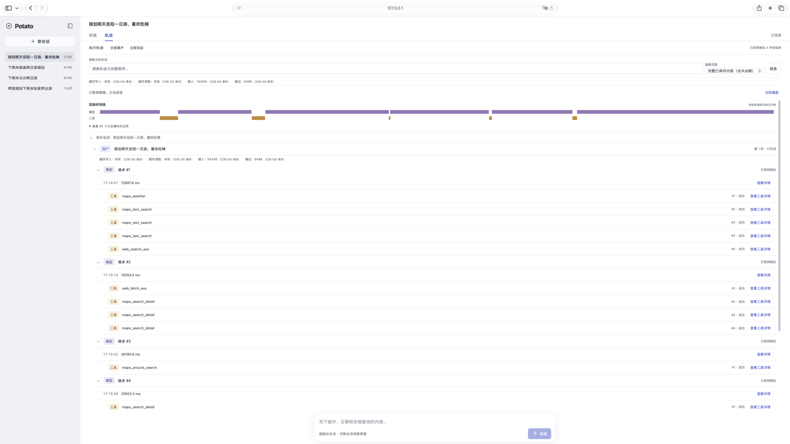

# Potato · 旅行助手

通过对话查询地点、比较交通路线、推荐餐饮，规划一天或多天的旅行行程，并在后续交流中调整安排。

- **旅行规划**：高德 MCP 提供地点、餐饮、交通和天气；Exa 搜索与正文读取按需要补充攻略、玩法和地点等资料。
- **本机会话**：保存历史，支持续聊、重命名和删除；切换会话保留草稿。
- **执行轨迹**：查看模型请求、工具调用、时间线和用量，搜索、定位及复制完整载荷。
- **旅行者偏好**：跨会话复用明确表达的稳定饮食、活动、交通和住宿喜好。

## 界面预览

对话视图：阅读旅行行程并继续调整。



执行轨迹：对照模型请求、工具调用和实际时间线。



## 快速启动

需要 Python 3.11+；前端构建需要 Node.js 20.19+ 或 22.12+。

```sh
python3 -m venv .venv
source .venv/bin/activate
python -m pip install -r requirements.txt
```

按 [.env.example](.env.example) 在项目根目录配置 `.env`，保留已有有效配置：

| 变量 | 用途 |
| --- | --- |
| `MODEL_ID` | 模型服务支持的模型名称 |
| `CONTEXT_COMPACTION_ENABLED` | 是否启用上下文维护，默认 `false`；启用须显式配置容量 |
| `MODEL_CONTEXT_WINDOW` | 当前模型服务实际支持的正整数 token 容量；开启上下文维护时必填 |
| `ANTHROPIC_API_KEY` | 模型服务 API Key；官方服务也支持 `ANTHROPIC_AUTH_TOKEN` |
| `ANTHROPIC_BASE_URL` | Anthropic Messages 兼容服务地址；官方服务留空 |
| `AMAP_MAPS_API_KEY` | 高德“Web 服务”类型 Key |

启用上下文维护后，每次请求按完整系统规则、日期、偏好、工具声明与消息计量。输入预算为模型容量减去 8,000 tokens 回答额度和至少 2,048 tokens（或容量 10%）安全余量；无法容纳时明确结束，已有查询资料仍可回看。可用的匹配 `tiktoken` 词表优先使用，否则按中文保守估算并用返回用量向上校准；处理记录明确标注近似计量。兼容服务的缓存字段口径不明确时，不将其与输入用量盲目相加。

高德 Key 的申请方式见[官方接入指南](https://lbs.amap.com/api/mcp-server/create-project-and-key)。Exa 使用免费免密钥 MCP，无需配置 Exa 或 Tavily Key，不自动切换付费服务。

首次使用或修改前端后构建页面，再启动服务：

```sh
npm ci --prefix frontend
npm run build --prefix frontend
python web.py
```

打开 <http://127.0.0.1:8000>，例如输入：

> 规划明天岳阳一日游，喜欢吃辣。

也可以明确日期、出发地点和交通偏好，再续聊修改其中一天或一个地点。回答在本轮结束后完整显示；“对话／轨迹”切换阅读方式，回看时点击“回到最新”恢复跟随。

日常只需激活虚拟环境并运行 `python web.py`。可用 `--port 8001` 修改端口，或用 `--data-dir /你的路径/旅行记录` 选择数据目录。

命令行入口为 `python agent.py`，支持同一进程内连续追问，输入 `q`、`exit` 或空行退出；CLI 不保存历史或长期偏好。

## 使用边界

- **资料与核实**：默认按规划需要主动获取资料，由旅行者出行前自行核实开放、预约及门票等信息；明确要求查证真实性或日期适用性时才专项核实。“几点开门”等普通问询查询资料后直接回答，已知冲突直接说明。普通回答保留必要来源，不生成逐项核实报告；搜索摘录和正文都可能不完整或过时，未知信息不编造。专项核实仅覆盖当前问题及明确续问，改期、历史恢复和回读不自动触发核实，见 [ADR 0007](docs/adr/0007-information-retrieval-with-opt-in-verification.md)。
- **预订入口**：普通规划附上已有资料中的入口，明确要求时再专门寻找；不因此自动核实所有政策、余票或操作流程。取得入口不代表有票或已预订，预约及支付由旅行者在外部完成。
- **旅行日期**：每轮按北京时间解释“明天”“下周末”等表达，已确定日期在跨日续聊和重启后保持，明确改期才更新。
- **偏好保存**：会话结束并连续闲置满一小时后，后台提取新输入中的稳定喜好；当前要求优先，单次日期、预算和酒店安排仅用于当前会话。删除聊天与删除偏好相互独立。偏好管理入口目前为顶部原位置的透明调试按钮，详见[偏好设计约定](docs/adr/0002-cross-session-traveler-preferences.md)及[验收记录](docs/acceptance/traveler-preferences.md)。
- **本机数据**：服务仅监听 `127.0.0.1`，面向单一旅行者、单进程，每次最多执行一轮。历史和偏好保存在默认 `.travel-data` 目录的 SQLite 中，重启保留；同一目录只允许一个服务实例。自定义数据目录也应放在 Git 之外，目前没有内置备份或导出。
- **中断与恢复**：关闭或刷新页面不取消任务。模型连接、超时、临时限流、服务端错误或空响应会在当前步骤最多追加 5 次重试，保留已完成工具结果；重试期间可停止本轮。认证、配额和参数等永久错误直接结束。正常 Ctrl+C 会在调用边界停止并释放连接；强制退出后，未完成轮次显示“中断，结果未知”，不会自动重放。重试耗尽后可手动“重新尝试”，会创建新轮次，可能再次查询。详细策略见[模型重试验收](docs/acceptance/model-retries.md)。
- **服务故障**：地图鉴权、额度或连接等故障会暂停当前进程的地图查询，修复后重启并按实际返回核对恢复情况；资料服务失败时保留可用地图能力。调用预算和超时见 [limits.py](travel_app/limits.py)，详细故障行为见[异常体验验收](docs/acceptance/exception-experience.md)与[Exa 接入验收](docs/acceptance/exa-sources.md)。CLI 与 Web 的进程内限速独立，同账号并行运行会叠加外部调用。

## 开发与验证

前端开发可运行 `npm run dev --prefix frontend`，Vite 将 `/api` 代理到本机 8000 端口；日常使用构建后的静态页面，无需启动 Vite。

自动测试使用可控模型和地图返回：

```sh
python -m pip install -r requirements-dev.txt
python -m unittest discover -s tests -v
pyright --pythonpath .venv/bin/python agent.py web.py travel_app
npm test --prefix frontend
npm run build --prefix frontend
```

真实高德连接检查：`python agent.py --check-amap`。它不调用模型，会消耗一次“杭州的西湖”地点查询，不替代完整旅行规划验收。

后端实现位于单个浅层 `travel_app/` 包，根目录保留 `agent.py` 与 `web.py` 启动入口；仓库内部使用 `travel_app.*` 导入。

按工作范围查阅：

- 代码与验证：[后端职责地图](docs/backend-map.md)、[验收索引](docs/acceptance/README.md)、[历史档案说明](.scratch/README.md)。

- 页面与交互：[本机页面验收](docs/acceptance/local-web.md)、[前端重设计验收](docs/acceptance/frontend-redesign.md)、[设计规则](DESIGN.md)。
- 偏好与恢复：[旅行者偏好验收](docs/acceptance/traveler-preferences.md)、[偏好恢复验收](docs/acceptance/preferences-recovery.md)。
- 领域与决策：[术语表](GLOSSARY.md)、[架构决策](docs/adr/)。
- 任务与协作：[Issue 跟踪约定](docs/agents/issue-tracker.md)、[代理工作准则](AGENTS.md)。
