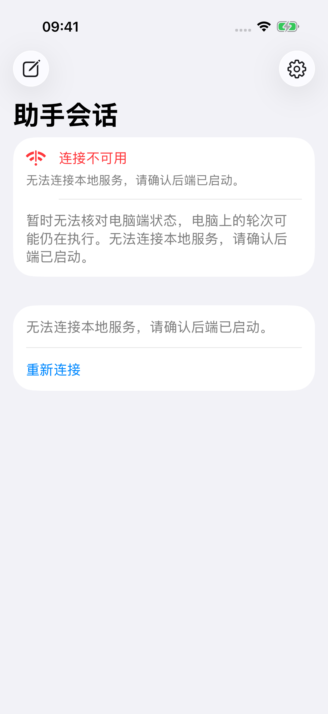
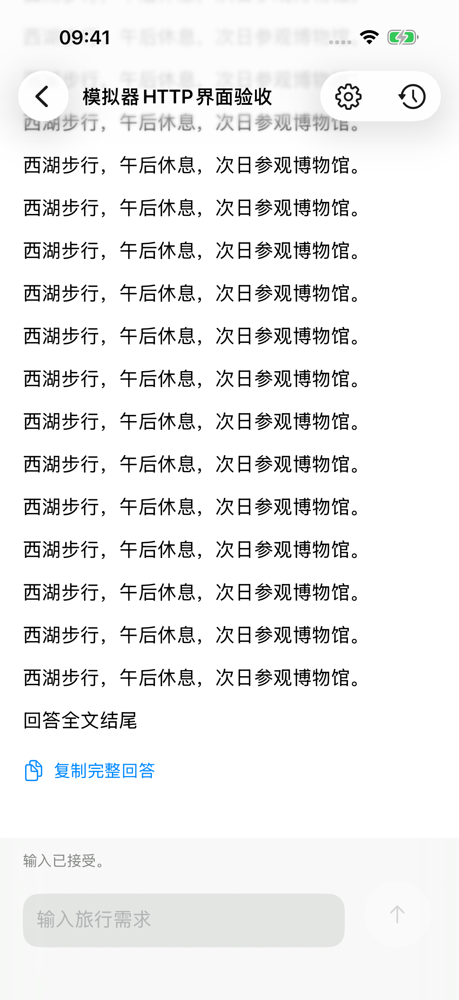

# iOS 本地模拟器调试

2026-11-05（Asia/Shanghai），在 `codex/ios-client` 上继续实现用户已确认的本地调试方案，审查基准为 `0f68ac03da177180bbdcd06b10fea23212491458`。用户选择当前优先使用同一台 Mac 上的 iOS 模拟器与后端，保留未来真实 iPhone 远程使用、私人 HTTPS 和 TestFlight 目标。现有后端业务、HTTP 契约和数据目录保持不变。

## 实现与验收范围

- App 装配在模拟器 Debug 且未保存地址时预置 `http://127.0.0.1:8000`，直接进入会话列表；已有地址保留，可在设置中切换或清除后重启。
- 共享 `SessionAccess` 仅在模拟器 Debug 允许 `127.0.0.1` 的 HTTP 根地址及有效端口；不允许其他 HTTP 主机、凭据、查询参数、片段或子路径。真机及其他构建仍要求 HTTPS，恢复已保存配置也按当前构建校验。
- 仅模拟器 Debug 的 App 注入 `127.0.0.1` 的 ATS 例外，不关闭全局传输或证书校验。IP 地址例外依据 [Apple 本地网络说明](https://developer.apple.com/documentation/bundleresources/information-property-list/nsapptransportsecurity/nsallowslocalnetworking)。
- 后端由用户单独启动，模拟器与 Web 使用同一后端及其会话、历史和旅行者偏好。连接失败提示检查本地后端并提供原有重试入口；HTTP 错误和解码错误保留各自含义。
- 自动化使用临时 SQLite 和可控外部模型、查询资源。新增 `http://127.0.0.1:18496` 测试服务，保留原六个 HTTPS 服务；不占用日常 8000 端口、不向用户实际旅行数据库发送测试输入。

运行步骤见 [iOS README](../../ios/README.md#本地模拟器调试)，公开边界见 [iOS 会话契约](../modules/ios-sessions.md)。

## 验证记录

本机环境为 Xcode 27.2、Swift 6、iPhone 17 Pro／iOS 26.5 模拟器。测试边界沿用已确认的 `SessionAccess` 公开接口、真实文件数据库与 HTTP，不对每个 VIPER 类增加旁路测试。完整命令见 [validation.txt](ios-local-debug/validation.txt)。

| 验证 | 本次结果与证据 |
| --- | --- |
| 先失败、后通过 | 本地 HTTP 原先被 `invalidAddress` 拒绝；首次启动仍出现配置提示；本地断连仍提示检查 Tailscale。分别补测试并实现后通过，最终套件再次覆盖。原始失败日志：[地址](ios-local-debug/http-red.log.gz)、[首次启动](ios-local-debug/startup-red.log.gz)、[本地重试](ios-local-debug/retry-red.log.gz) |
| 完整 iOS 套件 | **87 项中 86 项通过，1 项失败，0 跳过**；含参数化为 **127 例中 126 例通过，1 例失败**。64 项 Swift Testing、10 项快照、11 项导航测试均通过；失败为既有中文表格滚动用例的两处末列表头坐标断言。[机器汇总](ios-local-debug/test-summary.json)、[完整日志](ios-local-debug/full-suite.log.gz)、[干净后端就绪记录](ios-local-debug/full-suite-backend.log) |
| 失败用例独立复验 | 未改代码，以相同构建单独运行 `testChineseTableScrollsToLastColumn`，**1/1 通过**。[机器汇总](ios-local-debug/reading-retry-summary.json)、[日志](ios-local-debug/reading-retry.log.gz)。未确定首轮失败根因，不将复验通过写成完整套件首轮全绿；表格、对话布局及该测试源码均未改动 |
| 真实 HTTP 与界面 | 临时数据库验证已有会话读取、双客户端共用历史、续聊、新建和完整回答；模拟器验证免配置启动、断连提示、重试和 HTTP 发送。全部新增用例通过，见上述完整套件 |
| Release 限制 | **1/1 通过**：拒绝手动输入的 HTTP，并拒绝恢复 Debug 留下的 HTTP 配置。[机器汇总](ios-local-debug/release-summary.json)、[日志](ios-local-debug/release.log.gz) |
| 真机 Debug 编译与构建条件 | 无签名编译通过。[日志](ios-local-debug/device-debug.log.gz)。检查三个实际 App：模拟器 Debug 仅有 `127.0.0.1` HTTP 例外，模拟器 Release 与真机 Debug 均无 ATS 例外，设备范围均为 `[1]`，见 [产物元数据](ios-local-debug/build-policy.json) |
| 后端完整回归 | 首轮 361 项中 1 项既有预算用例报服务启动错误；该用例单独运行 **1/1 通过**，未改代码再次执行完整回归 **361/361 通过**。根因未确定；不将独立复验替代首轮结果。[首轮](ios-local-debug/python-first.log.gz)、[独立复验](ios-local-debug/python-isolated.log.gz)、[最终完整回归](ios-local-debug/python-verified.log.gz) |
| 静态检查 | iOS 测试后端 pyright **0 错误**、模块归属与依赖检查、文档导航与格式检查通过。[类型](ios-local-debug/types.log)、[模块](ios-local-debug/modules.log)、[导航](ios-local-debug/docs.log) |

本次不将模拟器结果作为 iOS 17 实跑、真实 iPhone、私网或 TestFlight 分发证据。真机 Debug 编译不等于签名或设备安装；原有远程使用验收仍独立保留。

以下截图均来自临时测试后端：

## Standards

以固定基准审查本次暂存变更，规范轴发现 **0 项规范违例、0 项需要处理的代码异味**，无遗留最高严重项。连接与失效规则仍归共享能力，默认地址配置位于 App 装配入口，测试沿用公开接口与系统边界。

## Spec

独立对照用户确认的本地调试范围，需求轴发现 **0 项问题**，无遗留最高严重项。默认连接、共用后端、真实 HTTP 读取／新建／续聊、连接失败提示与重试，以及其他构建保留 HTTPS 均有对应实现；保留远程使用目标。

对首轮表格失败追加只读复核：本次没有修改排版、对话布局或阅读测试，也未改变字号与方向；阅读测试冷启动后会显式切换到 HTTPS 测试服务。未发现本次变更导致失败的因果，但此审查判断不替代上述实际失败和独立复验记录。
