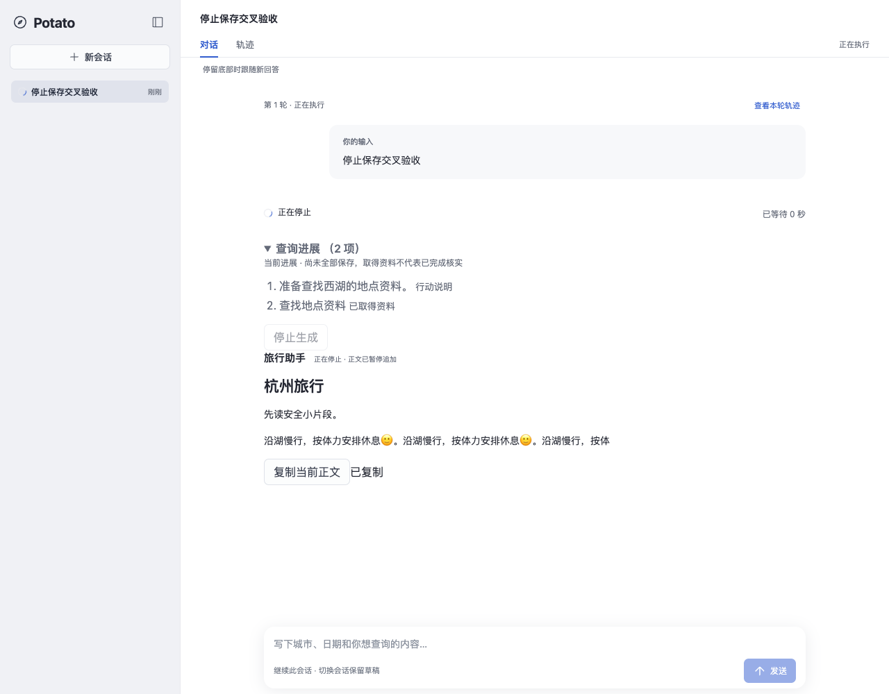
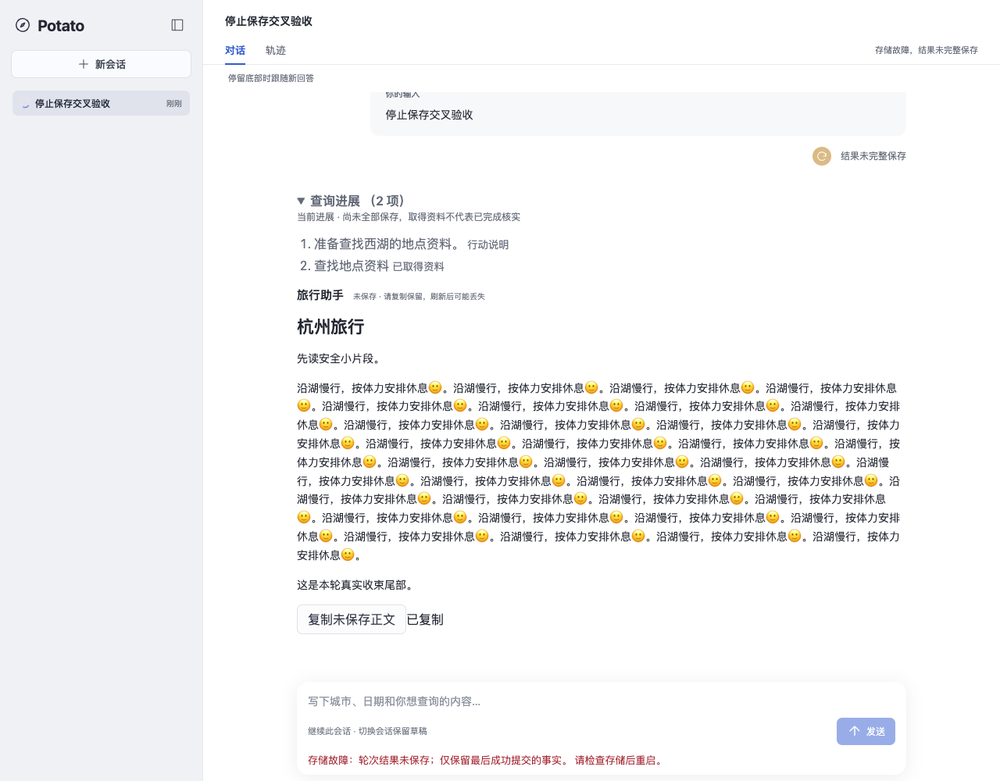
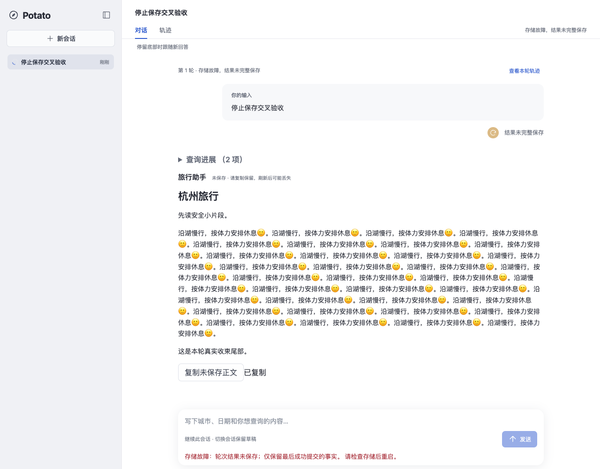
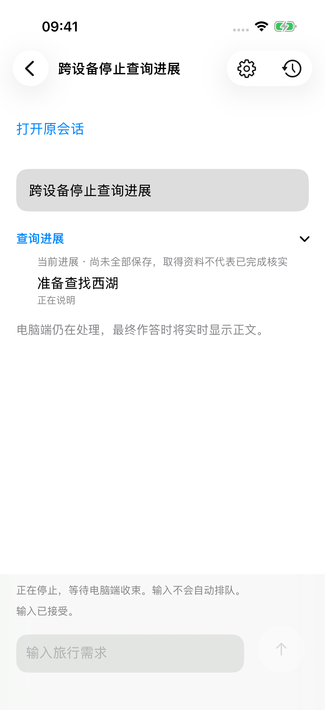
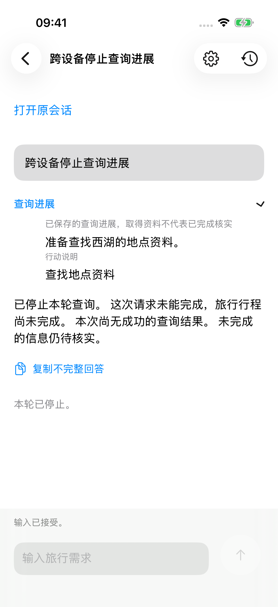
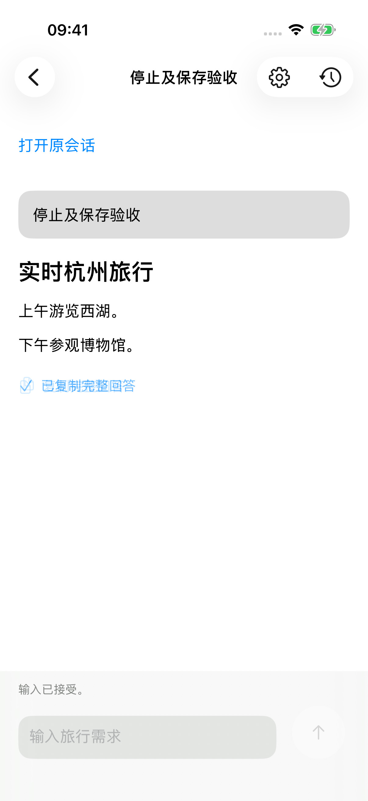
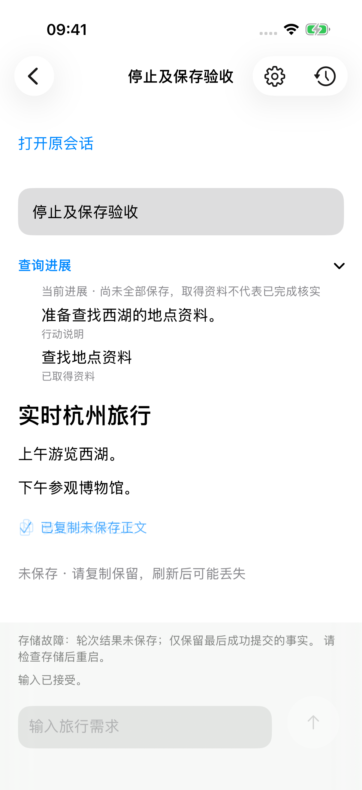
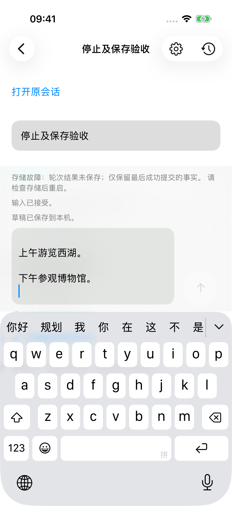

# 查询进展与正文停止收束（#116）

## 当前结论与范围

2026-11-08 在 #112 可靠进展回看与 #113 有界平滑之上验证停止。外部模型／地图客户端可控，规划、HTTP／SSE、本机记录与 SQLite 为真实实现。生产模型联合验收由 #117 交付，本记录不代表真机或生产供应商故障已发生。

本票修复两处归属与时序边界：Web 首次收到停止快照时只冻结同进程、数据集、会话和轮次的已有预览，不能冻结上一轮缓存；iOS 在采用远端停止快照之前，即使尚无回答，也先冻结此前可见的查询进展。两端既有 200ms 过渡立即取消待显示内容，真实累计对象仍可接收，停止释放后采用实际保存结果或可复制的未保存全文。

## 先失败再修复

- [Web 真实红灯](query-progress-stop/web-red.log)：先用协议规定的 `progress.preview` 通知建立上一轮缓存，再切到当前轮停止快照；当前轮查询文字缺失。修复归属选择后新用例通过。早期用 `service.state` 携带全文的测试设置不符合协议，已纠正，不作为产品红灯。
- [SessionAccess 红灯](query-progress-stop/ios-red.log)：2026-11-07 23:08，query-only 远端停止快照将旧 revision 1 可见进展替换成 revision 2 的迟到文字和工具状态。预冻结条件扩展到已有进展；最终绿灯见下述原生记录。
- Web 队列测试曾在尚未提交显示帧时捕获基线，已改为推进 16ms 并确认部分文字实际显示、远端停止状态已到达；没有放宽冻结断言。
- 后端重启续聊测试第一次受仍启用的故障注入触发器影响；恢复正常服务前显式解除注入，再验证未保存正文不进入模型上下文。

## 自动化公开边界

| 层次 | 结果与证据 | 覆盖 |
| --- | --- | --- |
| HTTP／SSE、真实规划与 SQLite | [59 项通过，37.330s](query-progress-stop/backend.log) | 查询停止、在途工具完成、正文停止竞争、完整／截断／模型失败／保存失败、停止中 409 与故障后 503、未保存全文、可靠事实回滚、同库重启和后续模型上下文 |
| Web 对话 | [40 项通过，42.9s](query-progress-stop/web.log) | 两类可见队列冻结、迟到更新、真实终态、当前前缀／未保存／完整／不完整 Markdown 复制、进展归属、既有阅读与折叠 |
| 原生 SessionAccess | [16 项通过，0.200s 测试体](query-progress-stop/ios-capability.log) | 查询阶段远端停止原红灯、两类冻结、保存／未保存收束、快照与 SSE 恢复及归属隔离 |
| 原生模拟器界面 | [首次 2 项通过，63.519s](query-progress-stop/ios-ui-first.log.gz) | 查询阶段远端停止、真实保存及未保存复制与持久进展 |

后端新增 `test_remote_stop_answer_keeps_real_outcome_and_reliable_progress` 的四种结果及 `test_stopped_query_preserves_real_tool_result_and_failed_save_boundary` 的两种保存边界；均通过公开路由观察，不替换内部规划、运行或存储实现。SQLite 故障经独立连接创建触发器注入。

同步 #114 集成 `1b3fa44` 后，独立 [Web 对话 42 项，43.8s](query-progress-stop/web-merged.log) 与 [公开查询 12 项，8.210s](query-progress-stop/query-merged.log) 再次全部通过，包含即时服务状态与快照双次序交接。此前 59 项后端和 40 项 Web 记录保留其原运行版本。

## 真实双页面与 SQLite 保存失败

独立端口 18526，在 `ffbc587` 加本票修复的 Web 生产构建上连真实 HTTP／SSE 和 SQLite；仅外部模型／地图可控。第一页面接收回答，第二页面点击真实停止按钮。第一页面的大块追加已开始显示后停止，推进界面时钟 500ms，仍保持长度 53 的可见前缀；复制的是对应长度 55 的 Markdown 原文。真实在途剩余正文继续返回，但停止中不会显示，另一输入仍返回 409。

对 `turn.finished` 的真实保存注入 SQLite 故障后，原轮次释放；两页面各自复制完整长度 556 的原 Markdown，且不混入查询进展。公开历史仍为 `running`、`answer=null`；此前可靠提交的进展分别为 `generated`／`completed`。服务 `accepting=false`，明确存储故障与未保存结果。[机器核对结果](query-progress-stop/web-live.json)。这些长度按 JavaScript UTF-16 代码单元计数。第一页面时钟用于确定性复现待显示队列；网络、停止请求与数据库故障均为真实实现。

## 最终集成与原生交叉

同步 #115 后基于集成 `4f725d9` 的最终组合：[公共原生能力 17 项、UI 2 项全部通过](query-progress-stop/ios-final.log.gz)，测试体分别 0.210s／65.042s，0 跳过。构建成功，iPhone 17 Pro 模拟器执行。查询阶段第一批进展出现后由另一 HTTP 客户端停止；第二批真实说明仍返回但界面保持第一批内容，发送禁用。实际响应与保存收束后，进展全文回看，模型提出的工具因停止而显示“未执行”。

保存失败场景先完成真实查询，可靠进展为行动说明及已取得资料；进入最终回答后本机点击停止，后续正文未扩展界面，最终 SQLite 保存失败则显示可复制未保存全文。用例将复制原文粘贴回草稿，逐字等于 `## 实时杭州旅行\n\n上午游览西湖。\n\n下午参观博物馆。\n`；公开历史回答仍为 `null`，可靠进展状态仍为 `generated`／`completed`。正常对照保持原完整保存／复制断言。

最终 [Web 对话 44 项，41.2s](query-progress-stop/web-final.log) 通过，包含两类队列停止、重试／降级／恢复、真实终态及复制交叉。最终 [公开查询 18 项，15.237s](query-progress-stop/query-final.log.gz) 全部通过，包含重试／降级／预算与停止收束组合；[生产 Python 类型检查](query-progress-stop/types-final.log) 为 0 错误，[最终 Web 构建](query-progress-stop/build-final.log) 成功。截图的原始身份、设备和时间见 [附件清单](query-progress-stop/ios-attachments.json)，完整 xcresult 保留在 `/tmp/potato116-final.xcresult`。

## 运行与限制

Web `npm run build --prefix frontend` 通过；结构、文档链接和 diff 检查通过。原生第一次后续构建因磁盘空间不足失败，不能视为编译通过；缓存清理与共享窗口串行后重跑。最终结果含 #114 SSE 状态接收和 #115 查询重试／降级，已完成上述原生组合复验。当前供应商实连、真机、后台系统调度及整段长行程的最终联合验收仍由 #117 按其范围记录。
