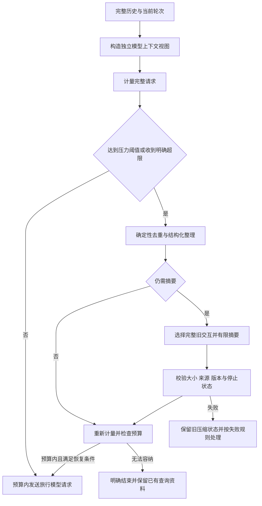

# 压缩模型上下文并保留完整助手会话历史

本项目在每个模型步骤发送累计协议消息，长助手会话或单轮多次工具查询可能超过模型上下文容量。上下文压缩以避免超限为首要目标，减少输入费用和响应时间作为次要收益；回答质量须独立验证，不能假定摘要必然改善回答。

## 决策与范围

2026-10-12 首轮设计已确认：压缩仅影响模型使用的上下文，完整聊天、工具结果与执行轨迹继续保留，供旅行者查看和追溯。压缩后的模型输入允许不再包含早期被否决候选的全部细节，因此继续规划所需的信息与完整历史承担不同职责。跨会话旅行者偏好仍独立管理，遵循 [ADR 0002](0002-cross-session-traveler-preferences.md)，压缩不承担长期偏好保存。

Web 与 CLI 共用压缩规则。Web 保存压缩状态并支持重启续聊；CLI 仅在当前进程内使用，保持现有的历史保存范围。

后续设计已确认采用较早历史摘要、近期原文和完整历史独立保留的骨架。完整历史与压缩后的模型输入分别管理，不能通过原地缩短现有累计协议消息实现压缩，以免改变聊天历史和执行轨迹的保存语义。

复用现有 SQLite 和共享 agent_loop，在每个模型步骤准备请求时构造独立上下文视图，不移植 Harness 的插件框架。原始协议与工具载荷继续按现有脱敏及保存规则留存；压缩版本关联被替换记录、原始历史水位和版本。异步摘要前固定输入，采用前复核历史水位、版本与停止状态，防止迟到结果替换已变化的上下文。

## 历史回读

首版支持助手在当前助手会话内有限回读被压缩的原始消息或工具结果，不引入向量检索。提供当前会话内关键词搜索和按记录标识读取：搜索返回短摘录及标识，读取采用分页和长度上限，并共用工具调用预算。回读结果仍作为历史资料处理，不能自动升级为当前已核实事实；不跨会话检索。摘要中遗漏的酒店早餐价格等旧细节可以通过回读恢复；仅保存原文并不等于模型能够访问原文。

每次搜索最多返回 5 条摘录，每条最多 200 字符；每次读取最多 4,000 字符，提供继续读取的位置。输出仍受当前上下文余量约束，必要时缩小页面。每轮搜索与读取合计最多 8 次，同时计入现有 64 次工具调用总预算。按原始记录去重，不检索重复请求快照；后端校验记录属于当前会话。上述数值为首版起始配置，没有本项目实测依据。

## 摘要保留合同

压缩后的必保留项包括当前有效旅行日期、人数与同行条件、预算及币种、饮食和交通限制、指定酒店与地点、已确认旅行行程、用户纠正、待澄清事项，以及关键查询资料的来源、适用日期和核实状态。预算从 5,000 元改为 3,000 元且仍指定原酒店时，须保留新预算和指定酒店；获得预订入口不能改写为已预订。被否决候选只保留必要结论，详细信息通过回读恢复。摘要须校验字段结构，并以这些场景验证质量；字段齐全不能证明语义正确，不能把必保留要求表述为已实现的无损保证。

日期采用已有的确定性旅行日期状态，不由摘要重新解释历史相对日期，遵循 [ADR 0003](0003-relative-travel-dates.md)。旅行者偏好仍每轮独立读取，偏好快照不固定写入摘要，摘要也不成为后台新增偏好的来源。查询资料与预订入口沿用 [ADR 0001](0001-domestic-planning-with-booking-entry.md) 的核实边界，历史正文和工具指令不能通过摘要变成系统规则。

## 压力预算与近期原文

达到上下文压力阈值时自动压缩，允许增加摘要模型请求和当前回答的等待，覆盖单个对话轮次内多次工具查询造成的增长。首版显示压缩状态并支持停止。

启用压缩时须显式配置当前模型的上下文容量，缺少容量配置时明确报错，不猜测窗口大小。预算覆盖系统指令、旅行者偏好、查询资料、工具声明及全部模型可见消息，并预留回答空间；优先使用匹配模型的 tokenizer，不可用时采用适合中文的保守估算和实际用量校准，估算不视为精确计量。

保留现有 8,000 tokens 回答额度，另预留模型窗口的 10%（最低 2,048 tokens）作为安全余量。若模型窗口为 W，则输入预算 P = W - 8,000 - max(2,048, ceil(0.1 × W))；达到 P 的 80% 时触发，压缩目标为 P 的 60%。每次发送前重新检查完整请求，超过 P 就不发送；系统指令、工具声明或当前用户输入本身无法容纳时，明确结束并说明原因。P 必须为正，所有预算按整数 token 保守取整；上述比例为首版起始配置，没有本项目实测依据。

近期原文目标为 P 的 20%，最多 8,192 tokens，按完整工具交互边界选择。当前用户输入和最近完整工具交互始终保留，即使因此超过近期原文目标，也不拆断或截断它们。摘要输出上限为 2,048 tokens 与 P 的 15% 中的较小值，不能为了达到大小目标删除必保留信息；摘要截断、校验失败或没有变小，均按既定失败规则处理。近期原文大小和压缩到 P 的 60% 是目标，最终是否能发送以完整请求不超过 P 为准。

允许压缩本轮较早、已经完成的工具交互，保留当前用户输入原文和最近完整工具交互；切分不拆开工具调用与结果。摘要请求本身同样须满足容量预算，历史过大时分批处理，每批计入摘要调用上限。

## 整理与摘要流程

摘要前先对工具结果做确定性去重和结构化整理，保留地点标识、价格条件、来源、适用日期及核实警示；原始结果继续保存。整理后仍有压力才调用摘要模型。首版不对任意文本统一采用头尾截断，不机械截断 JSON。

首版采用一份结构化旅行状态摘要、近期原文与原文引用，不引入完整分层摘要体系。后续将旧摘要与新变旧的历史合并，明确处理用户纠正和失效条件，通过回读恢复细节；接受仍有摘要漂移风险，须通过场景验证。使用当前模型和客户端发起独立摘要请求，采用旅行专用结构，记录独立用途、耗时及实际用量，暂不另配便宜摘要模型。

摘要请求使用专用摘要指令、旧摘要、带来源标识的待压缩记录及已确定旅行日期。历史记录作为待整理数据，不作为新指令；摘要器不执行工具，不携带完整旅行系统指令与地图工具声明。首版优先控制输入和职责，接受可能减少缓存复用的取舍。

中断轮次保存的资料经过整理后，仅提供来源标识、短摘录、适用日期与待核对状态，正文按需回读；系统输入保留固定规则、本轮时间和有效偏好。不恢复中断轮次的工具协议，不把旧资料升级为当前已核实事实。索引与摘录仍纳入完整请求预算，不能因使用索引就忽略其增长。

候选摘要先校验结构、非空、未截断和来源引用，替换视图须在计入摘要包装与引用后严格变小；重新计量完整请求后才决定是否发送下一模型请求。原始历史和上一有效压缩版本始终可用于失败恢复。上述检查验证结构与记录关系，语义保真仍须单独做旅行场景验证。

## 失败、停止与重启

摘要失败保留旧压缩状态；旧输入仍在安全预算内才继续，否则结束当前轮次并保留已有查询资料。服务明确报告上下文超限时，允许一次压缩恢复，只有输入确实缩小后才重试原模型步骤，不重新执行已完成工具，也不交给普通网络重试循环；仍失败就结束，停止操作始终优先。此处是对 [ADR 0004](0004-bounded-model-request-retries.md) 中上下文超限直接结束规则的明确例外；本方案已按 [Issue #56](https://github.com/lll1024/Potato/issues/56) 实施，恢复条件与验证见[上下文压缩验收](../acceptance/context-compaction.md)。

一次压缩最多 2 次实际模型请求，整个用户轮次最多 4 次，包括分批摘要和超限恢复。只对临时请求故障或可修复的摘要校验失败追加一次尝试；认证、配额、停止等情况直接结束尝试。沿用当前客户端的 60 秒请求超时配置，不套用普通模型步骤的 5 次重试，不将其描述为严格的整轮时间上限。

停止后不再发起摘要或旅行请求；在途摘要仍记录真实结果与用量，但迟到结果不采用。轮内已采用的压缩版本暂存，随轮次完成保存一并生效；重启时丢弃未完成轮次的候选版本，恢复上一有效版本，已保存的查询资料仍按现有规则作为待核对参考。保存失败时停止后续执行，不能显示为压缩成功。

## 可观察性

复用现有处理记录，显示开始、请求结果、校验结果及是否采用，并区分已用于本轮与已保存供续聊。摘要请求独立记录用途、耗时和实际用量，缺失用量保持未知；实际摘要模型调用须计入用量统计，但不作为普通旅行推理步骤或额外工具调用扣账。普通聊天不插入内部摘要，CLI 输出简短状态。首版仅做自动压缩，不新增手动压缩按钮或命令。

## 验收与限制

首版交付须同时通过机制与旅行质量验证。机制覆盖完整历史保留、工具配对、请求预算、回读隔离与分页、停止、重启、保存失败、摘要调用上限，以及超限恢复不重复执行工具；旅行质量覆盖预算修改、指定酒店、跨日续聊、否决候选回读、来源日期、待核实状态和未预订状态，并验证长会话多次压缩后的表现。使用当前模型做压缩前后对照，记录费用、耗时和回答质量，不预设压缩必然更便宜或更快。关键场景失败须继续调整，不能仅凭结构校验通过宣布完成。

上下文压缩是有损的模型输入整理，不减少聊天持久化存储量。原文可回读和结构校验降低遗漏风险，但不保证摘要无损；重复摘要仍可能漂移，保守 token 估算仍可能与服务实际计量不同。部署模型的容量配置与真实场景评估必须相匹配。

## 参考与阶段状态

参考 deepseek-harness 提交 `d743267388641bc76f17c45ce8b4c231aed1d32c` 的[上下文压缩说明](https://github.com/deepseek-ai/deepseek-harness/blob/d743267388641bc76f17c45ce8b4c231aed1d32c/packages/compaction/compaction-basic/README.md)。参考实现采用可选工具结果裁剪、较早消息摘要与近期原文保留，并把压缩结果作为模型可见历史的替换视图，保留原始日志；其[可回读压缩方案](https://github.com/deepseek-ai/deepseek-harness/blob/d743267388641bc76f17c45ce8b4c231aed1d32c/.agents/notes/proposed/feature/2026-07-06-recallable-compaction.md)仍是提案，本项目选择首版回读不意味着参考项目已经实现该能力。参考默认值不视为本项目已接受的决策。

用户于 2026-10-12 逐项确认设计分支并最终确认完整方案，本记录状态为 accepted。实施规格为 [Issue #56](https://github.com/lll1024/Potato/issues/56)，功能已按任务 #57–#64 实施；公开机制、真实模型质量、实际用量及耗时和修前失败记录见[上下文压缩验收](../acceptance/context-compaction.md)。最终集成审查、回归和合并授权另行处理，不以本文替代这些步骤。
